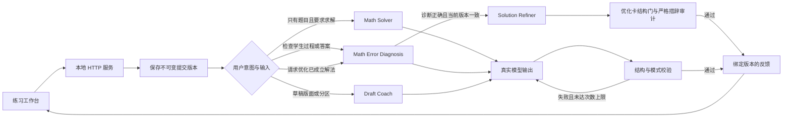

# 架构与运行

## 启动

```bash
python3 run.py
```

浏览器打开 http://127.0.0.1:8765 。服务仅监听本机回环地址。Python 3.10+，工作台使用标准库，无需 npm 构建。
模型有两个可选后端，由环境变量选择：

- **Codex CLI**（默认）：通过已登录的 Codex CLI 调用；`codex login status` 检查登录。`MATH_CODEX_BIN` 可指定程序路径，`MATH_MODEL` 可指定模型。
- **OpenAI 兼容 HTTP**：设置 `MATH_API_BASE` 后启用，不需要安装 Codex。`MATH_API_KEY` 提供密钥，`MATH_MODEL` 指定模型（必填），`MATH_API_STYLE` 选择 `chat`（默认）或 `responses`。接口地址若以 `/chat/completions` 或 `/responses` 结尾则直接使用，否则自动补全。

两个后端返回同一种内部结构，路由与结构门不区分来源；`/api/health` 的 `backend` 字段会显示当前选择。`available` 只表示已配置 HTTP 地址或找到了 Codex 可执行文件，不保证接口可达、密钥有效或模型可用。

启动后也可以从页面右上角「模型设置」修改后端与参数，无需重启：

- 优先级为**环境变量 > 页面保存 > 默认 Codex CLI**；设置 `MATH_API_BASE` 时页面显示“由环境变量覆盖”，保存会被拒绝。
- 页面设置写入 `.local/model_settings.json`；API Key 只存服务端，`GET /api/settings` 只返回 `has_key`，不返回明文。
- 「测试连接」会实际请求一次模型或运行 `codex login status`，前者可能产生少量费用。
- 相关接口：`GET /api/settings`、`POST /api/settings`、`POST /api/settings/test`。
`python3 run.py --port 8766 --db /绝对路径/练习.sqlite3` 可使用独立端口和数据库。
学生文本发送给用户已配置的模型服务，练习历史保存在本地 SQLite；项目不收集账号密码。

### Windows / macOS 差异

工作台不依赖系统 shell，两个平台使用同一份代码：

| 平台 | 启动 |
| --- | --- |
| macOS / Linux | `python3 run.py` |
| Windows PowerShell | `py -3 run.py`，或直接指定解释器路径 |

- `codex` 不在 `PATH` 时，用 `MATH_CODEX_BIN` 指向 Codex CLI 可执行文件。Windows 桌面版自带的位置形如 `...\app\resources\codex.exe`；该路径含版本号，升级后需重新确认。
- 文本一律按 UTF-8 读写，不依赖系统区域设置；中文 Windows 默认的 GBK 不再导致解码失败。
- SQLite 每次操作后关闭连接，Windows 下不会因句柄未释放锁住数据库或临时目录。
- 课件生成中的 PowerPoint 动画读回只支持 Windows PowerShell；其他平台会明确报告“未执行”，不会标记为通过。课件字体在系统缺失时由 PowerPoint 替换，结构检查仍然有效。

## 请求链路



四份原始 Skill 及各自原生卡片接口继续有效。工作台增加公共包装 `reply` 与 `result`：`reply` 面向学生，`result` 保存原生结构；诊断另有原文绑定契约。门只检查它明确覆盖的条件。

整个仓库的项目级入口是 `high-school-math-teacher-agent/SKILL.md`，根目录 `AGENTS.md` 提供同一套路由约定。Web 工作台设学生练习区和教师备课区：教师区接入 `lesson-materials-builder`，教案草稿经过参数核对、大纲确认、源码编辑、课件生成与版式复核；共用入口但不把课件流程混入学生作业诊断。若课件包含具体数学推导，需单独调用求解/诊断流程并记录其证据，课件版面检查不会替代数学审稿。

草稿描述出现多个题号/分区标记时，先进入原技能的 partition 出口，请学生确认归属，再提交某一块的描述做六维分析。标记只是一种提示，可能把同题不同方法也识别为多个区域，所以不据此断言题目数量。该路由修复来自本轮冻结评测发现的问题；冻结成绩保留原失败。

当前工作台可在包装层附加 `tool_requests`，不改变原生 Skill 卡片。仅允许非提示、非草稿任务提出最多3个请求；请求必须引用输入原文。宿主通过 `verification/exact.py` 执行受限等式代回或多项式恒等核验，真实返回非零时进入门反馈修正。数学工具使用 SymPy；可通过 `pip install -r requirements-verify.txt` 安装。未安装时不声称执行过核验。

表达式不交给 eval，也不执行生成的 Python：只接受受限 AST 语法、单个实变量、有限常数、有限次数幂和允许函数；每个外部工具调用最多10秒。代回前保留原始表达式 AST，因此不会把 `(x-1)/(x-1)` 在 x=1 处因约分而误判为有定义。原文引用匹配不证明表达式翻译等价，工具通过也不证明解集完备。

本轮三组对照评估的是 `runs/initial/frozen_source/` 中的运行契约，早于新增外部数学工具；后来的工具集成用独立机制测试与真实运行记录验收，不归入旧实验的组间增益。

## API

| 方法 | 路径 | 功能 |
| --- | --- | --- |
| GET | `/api/health` | 服务、当前后端和可用性；不保证网络或登录成功 |
| GET | `/api/settings` | 当前模型设置（不返回密钥） |
| GET | `/api/uploads/{sha256}.{ext}` | 读取本机附件（图片 / PDF / DOCX / TXT / MD） |
| POST | `/api/attachments/extract` | 提取 PDF / DOCX / TXT / MD 的数字文本；不处理图片 |
| POST | `/api/settings` | 保存模型设置；环境变量锁定时拒绝 |
| POST | `/api/settings/test` | 测试当前或待保存的模型连接 |
| GET / POST | `/api/sessions` | 查询 / 新建练习；返回 `archived` 标记 |
| GET | `/api/sessions/{id}` | 查询该练习全部提交 |
| POST | `/api/sessions/{id}/archive` | 归档或取消归档 `{archived: bool}` |
| DELETE | `/api/sessions/{id}` | 删除练习及其提交，并清理不再被引用的附件；被师生任务引用时拒绝 |
| POST | `/api/sessions/{id}/submissions` | 保存新版本并启动异步检查 |
| GET | `/api/submissions/{id}` | 查询单次任务状态及结果 |

提交含 `problem`、`solution`、`draft`、`request`、`mode`、`grade_level`，文本字段各不超过 20000 字。任意练习模式都可附带最多 3 个 `attachments: [{name, base64}]`（PNG / JPEG / WebP / PDF / DOCX / TXT / MD，每个不超过 5 MB）；服务端按内容哈希存入 `.local/uploads/<sha256>.<ext>`，提交版本只记录 `{sha256, ext, size, kind, mime}`，不保存 base64，也不保存原文件名（文件名可能含学生姓名）。附件不进入模型提示词。数字文档可通过 `POST /api/attachments/extract` 提取内置文本，由学生在界面上核对后填入题干或过程；扫描版没有文本层时返回空结果，不做 OCR。图片通过 `GET /api/uploads/<sha256>.<ext>` 在本机显示，**不进入模型提示词**，也不做手写转写。分析仍只依据学生填写的文字描述。
`mode` 为 check / hint / full_correction / answer_check / refine / solve / draft / partition。`refine` 先由 Math Error Diagnosis 检查；只有当前学生提交被判为正确、无首错并通过原文结构门时，才调用 Solution Refiner，优化卡再通过其结构与严格措辞审计。这个模型审查状态不是形式化数学证明。
`source` 默认 student；不能把 assistant 来源的文本作为学生过程。

## 版本与提示模式

题目、学生过程、草稿、反馈模式、学段与来源一起生成 SHA256 内容版本。
一个练习中的每次提交独立保存，历史原文不覆盖。即使旧调用晚于新提交完成，旧结果也不会成为当前结果。
提示模式一直保留；只有前端用户明确切换模式，或 API 明确提交 `allow_mode_change: true`，才切换到其他模式。
这项元信息约定不认证用户真实身份。导出 JSON 包含原文、历史结果和实际调用记录。

服务重启时，已失去进程句柄的 queued/running 任务标为 interrupted，不虚报仍在运行。已完成结果保留。
每个服务同时运行2个模型调用、最多接受4个未完成提交，超出时要求等待，避免无界排队。

## 数学与验证边界

模型生成的“核验通过”属于模型复核。结构门通过不等于数学正确；草稿门通过不等于版面观察属实。
本项目不做手写转写。照片内容需用户确认文字，草稿布局分析也不能据未提供字符判断数学对错。
完整课程评测的原始输出与模型辅助复核在 `evaluation/course-2026-10-22/`；人工评分只能由真实人员填写。

公式显示使用本地附带的 KaTeX 0.16.22（MIT，见 app/static/vendor/katex/LICENSE），无需 CDN 或 npm 构建。渲染关闭 trust，限制宏展开次数；学生文本仍通过 textContent 插入。


## 师生任务与证据版本

`app/teaching_loop.py` 将任务设计、学习证据汇总和补救教学三个新 Skill 接入同一数据库。教师发布固定原题，每项题目绑定一个练习会话；学生领取后使用现有诊断接口，教师读取该会话的当前提交。`learning-evidence-bridge/scripts/evidence.py` 按任务项聚合状态，保留提交 ID、revision 和版本指纹。补救教案与关联再练习绑定当前指纹，旧证据不能继续交接到备课。模型草案不是已核验试题，分享材料前由教师审阅。当前为本机单设备协作，不提供班级账号或跨设备访问。接口、完整链路与可复现验证见 `docs/teaching-loop.md`。
